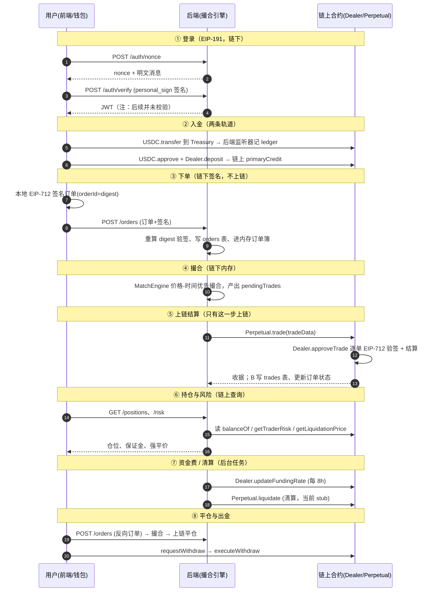

# MetaNode 永续合约系统 —— 面试总览与链路图

> 用途：面试开场「一句话介绍项目」+ 被问「整体架构」时的主干。看完这一篇，你能画出全图、讲清三条链路、说得出每个角色。

## 1. 一句话定位

**去中心化永续合约交易系统（教学项目），核心模型是「链下撮合、链上结算」。**

- 用户用 **EIP-712 签名订单**（不直接付 gas 下单）；
- relayer（**撮合引擎**）在**内存订单簿**里撮合；
- 只有撮合成功的 `trade()` 才**上链结算**，其余订单永远不上链。

对比中心化交易所：中心化交易所撮合+结算都在自己数据库里；本项目撮合在 relayer 内存里、**结算在链上合约里**，用户资产和成交由合约兜底。

## 2. 三个组件

| 组件 | 路径 | 技术栈 | 一句话 |
|---|---|---|---|
| 智能合约 | `perpetual-contract/` | Solidity 0.8.19 / Foundry | 资产账本 + 成交结算 + 资金费 + 清算 |
| 后端 | `perpetual-contract/others/backend/`（**完整版**） | Go 1.24 / go-zero + GORM | 撮合引擎 + 后台任务 + HTTP API |
| 前端 | `perpetual-contract/others/fe/` | Next.js + wagmi + supabase | 交易界面 / 持仓 / 水龙头 |

> ⚠️ **后端有两份拷贝**：`perp-backend/` 是简化快照；`perpetual-contract/others/backend/` 更完整（多了 funding/market/orderbook/fillsim 等）。面试若被问「改后端改哪份」，答：认准 `others/backend/` 完整版。

## 3. 三个角色（面试必背）

| 角色 | 链上身份 | 权限 | 做什么 |
|---|---|---|---|
| **用户 (trader)** | 钱包地址 | 无特权 | EIP-712 签名订单、入金/出金、被撮合成交 |
| **系统管理员** | `owner` | `onlyOwner` | 注册市场/设风参 `setPerpRiskParams`、设撮合引擎 `setOrderSender`、设资金费 keeper、保险账户等 |
| **撮合引擎 (relayer/orderSender)** | 后端私钥地址 | `validOrderSender` | 撮合订单、把成交结果 `trade()` 送上链 |

子角色（都归管理员配置）：
- `fundingRateKeeper` —— 每 8h 更新资金费率（`onlyFundingRateKeeper`）
- `insurance` —— 保险账户，兜底坏账
- `liquidator` —— 清算者（当前后端是 stub）

## 4. 一笔订单的完整生命周期（核心链路图）

**记住一句话串起来**：登录和下单都是链下（签名），撮合是链下内存，**只有成交后的 `trade()` 才上链**，持仓/风险查询直接读链上，资金费和清算是后台任务定时调链上。

## 5. 三条交互链路（方法级总览）

### 5.1 前端 → 后端（HTTP REST）

前端所有读/写都走 go-zero REST，22 个端点（详见 `01-前端到后端.md`）。核心几个：

| 操作 | 接口 | 后端做什么 |
|---|---|---|
| 登录 | POST `/auth/nonce` + `/auth/verify` | EIP-191 验签 → 发 JWT |
| 下单 | POST `/orders` | 验 EIP-712 签名 → 入库 → 进撮合 |
| 撤单 | POST `/orders/cancel` | 从内存簿移除 + DB 置 Cancelled |
| 查持仓 | GET `/positions` | 读链上 balanceOf + 强平价 |
| 查风险 | GET `/risk` | 读链上 getTraderRisk |
| 查深度 | GET `/orderbook` | 内存订单簿快照 |
| 下单预估 | GET `/order-preview` | 内存模拟吃单（fillsim） |

### 5.2 前端 → 合约（直接链上）

前端**不经过后端**直接碰合约的地方（详见 `02-前端到合约.md`）：

| 操作 | 合约方法 |
|---|---|
| 签名订单（不广播） | 本地 EIP-712 `signTypedData` |
| 授权 USDC | `USDC.approve(dealer, amount)` |
| 入金（链上轨道） | `Dealer.deposit(primaryAmount, ...)` |
| 出金 | `Dealer.requestWithdraw` + `executeWithdraw` |
| 建子账户 | `SubaccountFactory.newSubaccount()` |

### 5.3 后端 → 合约（链上，用私钥签名）

后端用配置的私钥（= `validOrderSender`）调链上（详见 `03-后端到合约.md`）：

| 场景 | 合约方法 | 后端入口 |
|---|---|---|
| 撮合成交 | `Perpetual.trade(tradeData)` | `SubmitPerpTrade` |
| 资金费结算 | `Dealer.updateFundingRate` | `SubmitFundingRateUpdate` |
| 查询类 | `balanceOf`/`getTraderRisk`/`getMarkPrice` 等 | 各 `Get*` 只读调用 |

## 6. 为什么这么设计（面试加分，背这套逻辑）

| 设计决策 | 为什么 |
|---|---|
| **链下撮合、链上结算** | 高频撮合若笔笔上链，gas 贵且慢；只有成交才上链，省 gas、低延迟 |
| **EIP-712 签名下单** | 用户授权订单但不用一直在线、不用为下单付 gas；relayer 拿到签名即可撮合 |
| **链上重新验签** | 撮合引擎**不可信也无妨**：`approveTrade` 链上重算签名恢复 signer，没被本人签过的单永远成交不了 |
| **orderId = EIP-712 digest** | 天然去重，且与合约里 `orderFilledPaperAmount[hash]` 对齐 |
| **paper + credit 双字段记仓位** | 多空都用一个模型表达（正=多、负=空），资金费/盈亏统一用公式算 |
| **手续费打进订单 Info 字段** | 后端不算钱，链上结算时按 maker/taker 角色收，保证「链上结算、链下记账」边界 |

## 7. 面试必讲的几个「内行点」（显得像你写的）

1. **JWT 只签发、不校验**：`routes.go` 没有 `rest.WithJwt`，业务接口身份来自请求体里的 `signer` 地址（自报身份），是安全缺口。
2. **下单验签可跳过**：`createorderlogic.go` 里 `if svcCtx.Chain != nil` 才验签，链客户端没配时不验。
3. **清算器是 stub**：`liquidator.go` 的 `checkSafeOnChain` 恒返回 true、`executeLiquidation` 全是 TODO，没真清算。
4. **两个接口是空实现**：`GET /withdraws` 和 `GET /liquidations` 直接 return。
5. **手续费不在后端算**：订单 `info` 里打包了 maker/taker 费率，链上 `Perpetual.trade` 结算时扣。
6. **两个合约都叫 `OracleAdaptor`**：`OracleAdaptor.sol`（Chainlink）和 `PythOracleAdaptor.sol`（Chainlink+Pyth），部署时选其一。

---

下一篇：`05-撮合系统深度拆解.md`（最复杂的一块，单独拆）。
