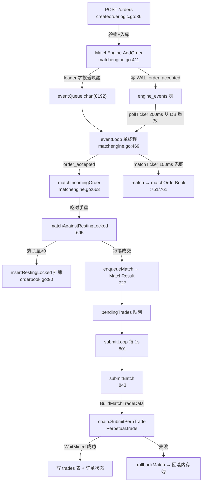

# 撮合系统深度拆解（MatchEngine + OrderBook）

> 用途：这是整个项目最复杂、面试最容易被深挖的一块。本页从「数据流 → 数据结构 → 启动 → 撮合 → 上链 → 回滚」逐步拆到方法级，看完能把这个引擎讲得像自己写的。
>
> 基准目录：`perpetual-contract/others/backend/internal/engine/`（完整版，不是 `perp-backend/` 那份简化版）。

## 0. 一句话定位

**链下内存订单簿做价格-时间优先撮合，所有订单/撮合动作先写 `engine_events` 表（WAL）做重放，撮合结果进 `pendingTrades` 队列，由独立 `submitLoop` 逐笔编码成 `tradeData` 调链上 `Perpetual.trade`，链上成功才写成交表和订单状态，失败则回滚内存簿。**

三个关键词：**WAL 重放**（可靠）、**leader 选主**（多节点）、**链上确认才记账**（结算边界）。

## 1. 数据流总览



## 2. MatchEngine 结构（matchengine.go:28-54）

| 字段 | 作用 |
|---|---|
| `orderBooks map[perp]*OrderBook` | **每个市场一个内存订单簿** |
| `pendingTrades []*MatchResult` | 待上链的成交队列（tradeMu 保护） |
| `eventQueue chan` | 8192 缓冲，本地下单后的低延迟唤醒信号 |
| `isLeader / recovered / lastEventSeq` | leader 状态 + 恢复水位 |
| `orderModel/tradeModel/eventModel` | GORM 模型（订单/成交/事件） |
| `chain.Client` / `redis` / `nodeID` | 链客户端、Redis（选主）、节点标识 |

## 3. 启动与生命周期（Start）

`Start`（matchengine.go:94-105）开 **2~3 个 goroutine**：

| goroutine | 条件 | 轮询间隔 | 职责 |
|---|---|---|---|
| `leaderLoop` | 仅 `redis != nil`（多节点） | 5s（TTL 15s/3） | Redis `SetnxEx` 抢锁 + 续租，抢到后恢复订单簿 |
| `eventLoop` | 始终 | poll 200ms / match 100ms | **单线程事件消费 + 撮合入口** |
| `submitLoop` | 始终 | 1s | 批量把 pendingTrades 提交上链 |

> 注意：**没有独立的 matchLoop**，撮合是在 `eventLoop` 内部被触发的（下面第 5 点）。

- **选主** `leaderLoop:235-259`：抢锁用 `tryBecomeLeader`（Redis `SetnxEx`），续租用 Lua 脚本比较后续期（`renewLeaderLease`）。锁 key 默认 `metanode:match-engine:leader`。
- **恢复** `recoverLeaderState:144-165`：成为 leader 后，读 `eventModel.LatestSeq` 作水位 → 清空内存 → 从 DB 恢复未成交挂单（`RestorePendingOrders`）→ 恢复未结算的撮合（`restoreUnresolvedMatches`）→ 标记 recovered。这样**重启/切换 leader 后能从 WAL 重放**。

## 4. 订单簿数据结构（orderbook.go）—— 面试重点

价格-时间优先 = **「双向链表按价格排序 + 同价位 list 按时间 FIFO」**：

```
OrderBook (orderbook.go:14)
├─ bids *bookSide  买边
├─ asks *bookSide  卖边
└─ entries map[orderId]*bookEntry   O(1) 定位撤单

bookSide (orderbook.go:33)
├─ levels map[priceKey]*priceLevel   随机查找
└─ head *priceLevel                  最优档（双向链表头）

priceLevel (orderbook.go:40)
├─ priceKey / price / totalRem
├─ queue *list.List                  同价位 FIFO 队列
└─ prev / next                       链表指针

bookEntry (orderbook.go:22)         单个订单在簿里的节点
├─ order / remain / price
└─ 所属 level + list.Element 指针    O(1) 撤单
```

- **价格优先**：`insertLevel:243-264` 把新价档按优劣插入双向链表，`head` 永远指向最优档（买边价高优先、卖边价低优先，`isBetter:284-289`）。
- **时间优先**：`enqueue:208-221` 在同价位队列里用 `entryTimeBefore`（先比 CreateTime、再比 DB id、再比 orderId）插入，实现严格 FIFO。
- **关键原语**：
  - `insertRestingLocked:90-115` —— 挂单（paper>0 进 bids，否则 asks）
  - `applyFillLocked:139-158` —— 减剩余量，减到 0 自动 detach+删除
  - `removeLocked:123-131` —— O(1) 撤单
  - `addRemainLocked:166-178` —— 回滚加量
- **价格口径**：`calculatePrice = |credit| / |paper| × 1e18`（matchengine.go:1018-1036）。

## 5. 下单入簿（AddOrder）—— 先写 WAL，再消费

`AddOrder`（matchengine.go:411-431）**不直接改内存簿**：

1. 算 `remain = |paperAmount|`。
2. 生产模式：`appendSimpleEvent("order_accepted")` 把事件**先写 `engine_events` 表（WAL）**，拿回自增 Seq；若本机是 leader，再 `enqueueLocalEvent` 投递到内存 chan 作唤醒提示（chan 满只打日志，靠 poller 兜底）。
3. 测试模式（无 eventModel）：直接 `matchIncomingOrder` 同步撮合。

**为什么先写 WAL？** 保证多节点/重启能从 DB 重放事件，内存 chan 只是低延迟提示，不是事实来源。

## 6. 撮合主流程（eventLoop）

`eventLoop`（matchengine.go:469-498）：任一触发源到达且 `hasLeadership() && isRecovered()` 时，先 `pollEngineEvents` 从 DB 读事件，再 `match()`。

- **事件消费**：
  - `pollEngineEvents:511-526`：`ListAfter(lastEventSeq, 500)` 读 `id > seq` 的事件，逐个消费。
  - `applyEngineEvent:540-571` 分发：`order_accepted → matchIncomingOrder`；`order_canceled → removeOrderInMemory`；`match_rollback → applyRollbackMatch`。
- **新单撮合（taker 模式）** `matchIncomingOrder:663-682`：
  - 取/建簿 → `matchAgainstRestingLocked` 吃对手盘 → 剩余量>0 则 `insertRestingLocked` 挂单。
  - `matchAgainstRestingLocked:695-725`：算 taker 限价 → 循环取对手方最优档（跳过同 signer 自成交）→ 成交量 = `min(takerRemain, makerRemain)` → **成交价取 maker 挂单价**（:717）→ `enqueueMatch` 记一笔成交 → 扣 maker 剩余量。
- **簿内交叉撮合（定时兜底）** `match:751-759` → `matchOrderBook:761-799`：
  - 循环 `bestCrossPairLocked`（买一价 ≥ 卖一价且非同一 signer）→ 取 min 成交量 → **谁更老谁是 maker**（`orderOlder`），成交价取 maker 价 → `enqueueMatch` → 双边扣量。

## 7. 成交如何上链（submitLoop → submitBatch）

`submitLoop`（:801-816）每 1s 取出 `pendingTrades`，按 `BatchSize` 分批 `submitBatch`。

`submitBatch`（:843-930）对每笔 MatchResult：

1. 前置检查：`chain == nil` 或订单过期 → 直接 `rollbackMatch`。
2. `chain.BuildMatchTradeData(taker, maker, amt)` 组装 `tradeData`（`tradedata.go:167-192`，即 `abi.encode(Order[], bytes[], uint256[])`，`orderList[0]` 必须是 taker）。
3. `chain.SubmitPerpTrade(ctx, perp, td)` 发交易（`client.go:376-425`）：
   - `perpABI.Pack("trade", tradeData)`
   - 取 `PendingNonce` + `SuggestGasPrice`（乘 gasMultiplier）
   - `EstimateGas`（上限 maxGas）
   - 构造 `LegacyTx` → `SignTx` 签名 → `SendTransaction`
4. `bind.WaitMined` 阻塞等收据，`rec.Status != 1` 视为失败。
5. 成功后：`applyFillStatus` 更新订单 DB 状态 → 写 `match_settled` 事件 → `tradeModel.Insert` 写 `trades` 表（含 TxHash、BlockNumber）。
6. **任何一步失败 → `rollbackMatch:939-955`**：写 `match_rollback` 事件 → `applyRollbackMatch` 把 taker/maker 剩余量加回内存簿。

## 8. 手续费：后端不算钱

订单里的 `MakerFeeRate/TakerFeeRate` 通过 `PackOrderInfo`（eip712.go:36-50）打进**签名订单的 `info` 字段**，随 tradeData 上链，由链上 `Perpetual.trade` 按 taker/maker 角色结算。

`trades` 表虽有 `taker_fee/maker_fee` 列，但 `submitBatch` 插库时**不填这两个字段**——链下不重复算，只记账。这是「链上结算、链下记账」边界，面试要能讲清。

## 9. fillsim：只读模拟成交

`fillsim.go` 是**只读模拟成交**，与真实撮合同一套价格/对手盘遍历逻辑，但**不改簿、不产生事件、不排队上链**。

- `OrderBook.SimulateTakerFill`（fillsim.go:23-93）：`RLock` 下从最优档开始，用同一套 `priceCrosses` 判限价、跳过自成交，逐档累加，返回 `FilledPaper / UnfilledPaper / AvgPrice / WorstPrice / Levels`。
- **用途**：`GET /order-preview` 下单前的价格预估/滑点保护（`orderpreviewlogic.go:56-60`）。
- 与真实撮合的关系：**读同一份内存簿、复用同一套规则**，是「所见即所得」的预估，不是另一条撮合路径。

## 10. 面试问答预演（撮合这块）

**Q：撮合引擎怎么保证多节点只有一个在撮合？**
A：用 Redis 分布式锁 `SetnxEx` 抢锁 + 周期续期（leaderLoop），只有抢到锁的节点才是 leader、才消费事件并撮合；抢到锁后先从 `engine_events` 表恢复未成交订单。

**Q：下单后订单怎么进订单簿的？**
A：不是 `AddOrder` 直接写内存簿，而是先把 `order_accepted` 事件写进 `engine_events`（WAL），再由 eventLoop 单线程消费事件时调 `matchIncomingOrder` 撮合并挂簿——这样重启/切主都能从 WAL 重放。

**Q：价格-时间优先怎么实现？**
A：价格用「双向链表按价格排序、head 指向最优档」，时间用「同价位 list 按 CreateTime/id/orderId FIFO」；两档同时满足时，更早挂的单当 maker。

**Q：撮合出的成交怎么上链、失败了怎么办？**
A：撮合结果进 `pendingTrades`，submitLoop 每 1s 编码成 `tradeData` 调链上 `Perpetual.trade`，`WaitMined` 等收据；成功才写 trades 表和订单状态，失败就写 `match_rollback` 事件回滚内存簿。

**Q：为什么成交价取 maker 价？**
A：限价单成交价就是它自己挂的价格，taker 主动吃单接受 maker 的报价，符合「taker 吃 maker」的模型。

---

相关：`00-总览与链路图.md`（整体）、`03-后端到合约.md`（SubmitPerpTrade 细节）、`04-后端核心引擎怎么跑.md`（eventLoop 在启动里的位置）。
